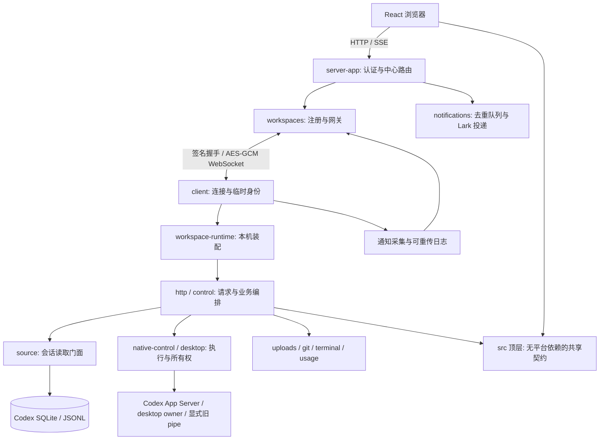

# 架构、依赖与状态地图

此文补充 [模块结构](../architecture.md)，记录治理时确认的真实职责、边界和演进约束。细粒度依赖由架构检查从源代码重新解析，文档不维护一份易过期的逐文件边表。

## 产品与部署

产品是面向自有 Codex 的多工作空间观察和控制台。浏览器提供账户、工作空间、会话、目标/消息/审批、文件/Git/终端、用量和通知管理。中心 Server 拥有账户与设备、工作空间注册、通知投递；每台机器的 Client 拥有本地 Codex 数据读取与执行能力。

一体模式也经过真实加密 WebSocket。`server/app.ts` 是大量接口测试所用的本机装配入口；生产分别由 `server-app.ts` 和 Client 装配。它不是可直接删除的重复生产入口。

## 边界与权威来源

| 概念 | 当前权威模块 | 依赖/修改约束 |
| --- | --- | --- |
| 共享 API 数据结构 | `src/types.ts`、顶层 `*-types.ts`、`workspaces.ts` | 与浏览器/Node 运行环境解耦；server 不依赖 feature 内部类型 |
| 浏览器认证、请求、SSE | `src/api.ts` | token 和 HTTP 错误在此处理；SSE 保留流式生命周期 |
| 工作空间隔离与取消 | `src/workspace-scope.ts` | URL、草稿命名空间与切换取消统一处理 |
| 会话列表/详情/时间线 | workspace/session hooks 与纯模型 | hooks 拥有 IO 和状态转换，纯模型拥有合并/分组算法 |
| 控制表单 | `features/control` | 草稿/请求 ID/回执在 hooks；共享请求/结果类型在顶层 |
| 设计与布局 | `styles.css` 有序导入、`styles/*`、`shared/ui` | 保留 CSS 覆盖顺序；通用展示不反向依赖业务 feature |
| Server 身份 | `auth.ts`、`authorization.ts`、`http/access.ts` | Server DB 是用户、设备和审计权威；authorization 拥有设备复核规则，HTTP adapter 负责身份提取与响应 |
| 工作空间转发与能力校验 | `workspaces/gateway.ts`、`transport/protocol.ts` | 协议 schema、帧大小/容量、签名、分片不可弱化 |
| 本机能力装配 | `workspace-runtime.ts` | 创建依赖并负责 close；不把业务继续堆进入口 |
| 控制请求/幂等/队列 | `control.ts`、`message-queue.ts` | 用户请求的持久回执与队列语义不同于原生执行会话；与 native-control 分别持有 keyed executor |
| 原生运行时与桌面所有权 | `native-control.ts`、`native.ts`、`desktop.ts` | 一个会话不得出现第二 writer；不确定发送不能自动重放 |
| 会话事实 | `source.ts` + 专用 readers | Codex 原始库只读；SQLite 与 rollout 是不同版本和故障回退来源 |
| 上传与文件读取 | uploads、project-files、file-preview、media | 上传绑定/范围/路径校验不同，不合并成万能文件服务 |
| 用量与计价 | usage、usage-parser、usage-query、pricing | parser 版本决定缓存失效；配置 JSON 是价格权威 |
| 通知 | reporter/report-store、service/store、Lark adapters | Client 采集事实，Server 决定投递；LarkReadTracker 按私聊卡片与收件人匹配已读，CompletionNotifications 发布网页快照，不能合并两端队列 |
| 用户操作审计 | `audit.ts` | 唯一参数化写入；调用方拥有事件含义/时机及事务，AuthStore.log保留公开契约 |
| 运行配置 | config、cli、client/config、平台启动器 | 优先级是 CLI > 进程 env > 启动器 .env > 默认值；Node 入口不自动加载 .env |

## 状态所有权

| 状态 | 唯一拥有者/存储 | 生命周期与一致性 |
| --- | --- | --- |
| 用户、密码、登录设备、审计 | Server AuthStore / monitor.sqlite | 设备到期、撤销和角色变更必须在执行时复核 |
| Client 临时授权 | client/access 本地库 | 从加密请求注入，不能替代中心最终授权 |
| 工作空间注册/AES 密钥 | WorkspaceStore / Server DB | 密钥固定持久化，握手证明不传密钥；重连不派生新密钥 |
| WS 连接/请求/背压 | 每实例 Gateway / MonitorClient | 断连取消，握手隔离，close 清理；不跨实例共享 |
| 会话执行/审批 | NativeDesktopControl / native runtimes | 原请求进程/会话绑定，断连取消审批，禁止在替代进程重放 |
| 控制请求/队列/附件绑定 | Client SQLite 的 control/queue/upload tables | 请求 ID 幂等，发送结果不确定时保留事实不自动重试 |
| Codex 会话与历史 | Codex SQLite / JSONL | 只读读取，可容忍版本差异/部分写入；Monitor 缓存不是事实权威 |
| 会话索引/outline/图片缓存 | Source readers / ImagePreviews 实例 | 按来源版本失效，限制体积和并发，close 释放 |
| 用量扫描断点/派生缓存 | UsageStore / usage.sqlite | 可重建；parser/价格变化触发对应失效 |
| 通知事件与待答问题 | Client report-store | Server 确认后清理，重启/重连可重传 |
| 通知策略/投递/去重 | Server notification store | 持久去重，有限重试，不确定回执不能当成未发送 |
| Lark卡片已读跟踪 | Server LarkReadTracker / 内存Map | 按消息 ID 和收件人匹配，支持发送响应前到达的回执；配置变更使旧关联失效 |
| 网页完成通知 | Server CompletionNotifications / 内存列表和 SQLite 去重 | 上报提交后发布，关闭广播给所有连接。SSE 重连返回当前快照 |
| 认证 token | 浏览器 localStorage 或 sessionStorage / api | remember 决定位置；logout 清理两处并广播 |
| 草稿、请求 ID、附件引用 | control hooks / sessionStorage | 按账号/工作空间/会话隔离；成功后清理，失败保留 |
| 主题、布局、新建偏好 | 对应 hook / localStorage | 用户展示偏好，不是服务器业务事实 |
| 当前列表/详情/查询/展开 | 对应 feature hooks / React | SSE 通知失效，HTTP 重新读取，取消过期请求 |
| 概览面板与排序 | useRunningOverview / localStorage + React | 面板为本次访问状态，只有显式重排写持久偏好，键包含用户与工作空间/会话身份 |
| 概览历史与阅读锚点 | useOverviewSession / DetailLoader | 每面板拥有取消/轮询/历史合并，隐藏/离线停请求，放大不重建历史 |

## 技术方案清单与兼容约束

- TypeScript strict + React 19 + Vite；Express 5 + Node 24 SQLite；tsx 的 Node test runner；Playwright 桌面/移动 Chromium。无需新增状态框架、ORM、通用 DI 或测试框架。
- HTTP/SSE 用于浏览器；WebSocket/AES 用于 Server/client；原生 JSON-RPC、owner IPC、显式旧 pipe 用于不同会话所有权。这些协议不属于同义重复。
- Zod 校验外部输入，TypeScript 表达内部契约。不能用仅编译期类型替代运行时校验。
- 多个领域错误类携带不同恢复语义：ControlError 的 uncertain/code、HTTP ApiError 的 status/state、文件/Git/终端的领域失败。统一日志格式前先保留这些语义。
- 通知、HTTP、原生执行、SSE 的重试条件不同；禁止以通用 retry 包装器抹平幂等性与不确定结果。
- Windows ConPTY 与 macOS shell/权限路径是产品支持约束。自动测试不能替代真实桌面审批、macOS 权限或生产升级验收。

## 已识别偏离

初始重复/越界包括 Attachment、Project、Goal/Receipt 跨端定义、三处授权 SQL/复核顺序、两套 per-thread promise lane、图片请求绕过统一 API、部分视图直接请求/持久化、无调用方 OverviewCards、用量类型环，以及 CI 遗漏单元/接口检查。逐项状态和优先级见 [任务池](backlog.md)。文件较长本身不是抽象依据；通知服务和任务概览须先按状态与行为确定边界。

治理后上述已迁移或删除，新增机器约束见 ADR-004/007/009。按 feature 目录聚合时仍存在 control 使用 GitBranchSelector、git 使用 PromptForm，以及附件使用 workspace 会话选择器的双向组合关系；它们通过具体组件契约协作，没有文件级类型/运行时环。当前不为目录图形式改造为复杂的 render callback 链；若未来拆为独立包，再按包契约重新选择归属。
