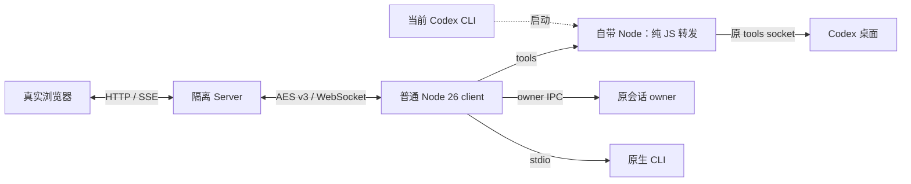

# macOS 完整桌面控制测试：授权复测

2026-11-15，Asia/Shanghai。对应代码 `72c13298bf3664e7df913defa7aa6c9efc778215`。本次在用户授权后继续验证真实桌面控制，承接 [首轮实机报告](macos-client-test-report.md)。当前快照已新增终端及 sharp，与首轮的 `75c9750` 不同。

**控制链路已通过临时 tools 转发进程连通，真实 Monitor 完成了新建、发送、运行中追加、附件读取、目标操作、停止和压缩；两项停止语义未通过，普通 Node 直连和独立后台部署仍未成立。** 不能将这些结果概括为原部署方式已完整兼容。

本次依赖重新安装成功，完整构建生成 `dist/server.mjs`、`dist/terminal-worker.mjs` 和 Web 产物；25 项桌面控制相关回归全部通过。实际控制验证使用真实 Codex 会话、原 owner、真实 Server/client 和 Chromium 浏览器，未注入 fixture 控制器。

测试期间，工作区在 19:58 快进至 `4b1ff95238d5037e87396e43ca3243d8ceee4448`。本轮运行的是 19:34 构建的 `72c1329` 产物和此前已启动的服务；三个控制入口文件 `server/control.ts`、`server/desktop.ts`、`server/native.ts` 在两提交间没有差异。新增浏览器完成通知和主机资源上报未纳入本轮验收。

**运行环境与鉴权结果**

| 方式                                                    | 结果       | 实测证据                                                                                                                                            |
| ------------------------------------------------------- | ---------- | --------------------------------------------------------------------------------------------------------------------------------------------------- |
| 普通 Node 26.12.1 直连原 tools socket                   | FAIL       | 已放开 agent 执行权限，仍被桌面记录为 `missing-code-signing-identity` / `untrusted-code-signing-identity`；projects/state 无 RPC 回执               |
| OpenAI 签名的自带 Node，在当前 Codex CLI 下运行只读探针 | PASS       | `/Applications/ChatGPT.app/Contents/Resources/cua_node/bin/node`，v24.22.1、arm64、Team ID `2DC432GLL2`；projects 返回 7 项，threads 返回可解析结果 |
| 同一个自带 Node，在普通 Terminal 的干净环境运行         | FAIL       | 无 CODEX_* 继承变量，父进程为 zsh；桌面明确记录 `untrusted-process-ancestry`                                                                        |
| 用自带 Node 直接启动完整 client                         | FAIL       | sharp 0.35.5 的原生模块被系统库校验拒绝，`ERR_DLOPEN_FAILED`，提示进程与映射库具有不同 Team ID                                                      |
| 普通 Node client + 自带 Node 的临时纯 JavaScript 转发   | 条件下可用 | 保留原桌面鉴权；转发进程由当前 Codex CLI 启动，仅承接本次测试允许的 tools 请求；真实 Monitor 的 projects/state 变为 available                       |

桌面仍为 `/Applications/ChatGPT.app` 内的 `com.openai.codex`，版本 26.1111.21308 / build 27194。CLI 为 `codex-cli/CodexCLI.app/Contents/MacOS/codex`，0.169.0-alpha.11.1。测试保留原应用与 Node 二进制的签名及鉴权设置。

**临时转发的具体范围**



临时进程监听私有短目录中的 Unix socket，权限 0600。它只允许 `list_projects`、`list_threads`、当前项目的 `create_thread`，以及对专用测试会话的 `send_message_to_thread`；从创建回执取得的新测试会话才加入允许列表。正常 Node 继续承载 client、SQLite、sharp 和 Server 连接。

转发脚本保存在私有测试目录，未加入生产实现。该结果依赖当前 Codex CLI 的进程祖先关系；同一自带 Node 在普通 Terminal 已失败，因此没有据此宣称 LaunchAgent、独立 Terminal 或长期后台部署可用。

**真实 Monitor 操作结果（使用临时转发）**

| 操作                     | 结果             | 验收依据                                                                                                               |
| ------------------------ | ---------------- | ---------------------------------------------------------------------------------------------------------------------- |
| 工作空间与控制状态       | PASS             | darwin 工作空间在线；projects=7，目标会话 available=true                                                               |
| 新建                     | PASS             | 请求 `2e414bc9-de0f-4148-9d50-f836be77f832` 成功；新会话真实输出 `MAC_REAL_MONITOR_NEW_OK_02`                          |
| 空闲发送                 | PASS             | 回执 succeeded、mode=start；历史中只有一次对应回复                                                                     |
| 发送去重                 | PASS             | 原 request ID 再提交返回原成功回执，对应回复仍只有一次                                                                 |
| 运行中追加               | PASS             | 提交时等待命令仍运行；回执 mode=append；投递前后 turnId 相同，最终标记在同一 turn 出现一次                             |
| 附件上传和发送           | PASS             | 上传包含随机 UUID 的文本文件；提示中不包含文件内容，模型经真实附件路径读取并回复该行                                   |
| 目标设置与启动执行       | PASS             | goal.set 返回 active，且实际启动指定的可控等待命令                                                                     |
| 目标暂停                 | PASS             | goal.pause 和随后读取均为 paused；已有轮次继续运行，符合当前页面语义                                                   |
| 目标继续                 | PASS             | goal.resume 返回 active 并送出继续执行指令                                                                             |
| 停止当前轮次             | PASS             | interrupt 回执成功；指定 turn 在本机历史中确认为 interrupted；重复提交原停止请求未重复执行                             |
| 恢复后立即停止时暂停目标 | FAIL（即时读取） | resume 成功约 101 ms 后停止；停止回执成功，但紧接着读取目标仍为 active，不能将该附带语义判为通过                       |
| 停止时回收 Shell         | FAIL             | 已启动的等待 Shell 在停止后仍存在；本轮 API 场景观察 3 秒，另两次 owner 场景观察 10 秒仍存活；测试程序释放信号后才退出 |
| 目标清除                 | PASS             | goal.clear 成功，随后 goal/get 为 null                                                                                 |
| 压缩                     | PASS             | 提交成功后约 26,711 ms，观察到新的 contextCompaction 项及 completed turn                                               |
| 真实页面发送             | PASS             | Chromium 打开真实工作空间，在页面填写并点击“发送消息”；桌面执行后，HTTP 历史与页面都显示一次 `MAC_REAL_UI_SEND_OK_02`  |
| 最终状态                 | PASS             | 两个专用会话空闲、目标为空、消息队列为 0；测试进程和监听端口已关闭                                                     |

本次通过 Monitor 新建的会话 ID 为 `01a1df1c-7fe1-7942-97b6-83ef11c3013e`。追加发生在 `01a1df1c-a48b-7533-8035-45d1e0c3945b`，停止的是 `01a1df1d-15eb-78d1-b7f2-7af2309dac5e`，压缩完成 turn 为 `01a1df1d-3cfb-7d62-a842-a92faed6dac3`。

**停止语义的具体边界**

恢复目标的回执时间为 20:09:54.453，停止回执为 20:09:54.554，20:09:54.603 读取仍显示 active。测试随后清除了目标，未把这一观察扩展为“目标永久不会暂停”。单独的 owner 实验中，在启动轮次之前设为 active 的目标，停止后能够正确变为 paused；而在运行中将 paused 改为 active 后立刻停止，也出现了即时读取 active 的结果。此处存在需要复核的时序或状态同步问题。

回收检查针对记录了 PID 的专用等待进程。退到后台的等待和使用 `yield_time_ms=30000` 的前台等待，都出现了轮次已 interrupted、Shell 仍存活的情况。它们均已通过测试专用信号释放，不存在遗留等待进程。该结果不能包装为“停止会终止所有已启动命令”。

建议后续在 `server/native.ts` / `server/control.ts` 的停止流程核对同一目标的实际暂停结果，并为“恢复后立即停止”补回归；若需要补偿，应保留目标和 turn 的一致性检查，避免改动后续替换的目标。Shell 回收应单独明确执行器的取消能力与职责，不能靠扫描并终止其他进程补齐语义。

**普通 Node 直连与内置工具对照**

在转发实验之前，真实 Monitor 的发送请求保留为 queued，已通过取消接口清除；新建、目标指令、压缩及停止各有可持久查询的 unknown 回执，未重发这些不确定请求。对应测试标记未出现在会话输入中。原页面中发送、附件、压缩和停止均不可用，并保存了截图。

内置工具另创建了“macOS 桌面完整控制测试”（`01a1deff-683e-7f30-8c05-33d02cc55835`），验证空闲发送、真实运行中追加和 owner 控制。一次短等待在追加前已自然结束，没有计作运行中追加通过；后续改用信号协调，明确记录投递前后同一 turn 均为 inProgress、Shell 存活，最终同轮回复包含一次追加标记。

独立目标探针验证了 set、pause、resume、clear 与执行标记；模型输出完成标记后，goal/get 返回 null，没有观测到明确的 complete 对象，因此这部分未作为“模型自动上报目标完成”的验收证据。

**证据与实际执行入口**

私有目录：`$HOME/codex-monitor-macos-full.GpVHOi`，记为 `$MAC_FULL_OUT`。其中保留本机测试凭据，报告仅引用脱敏路径、状态、版本和专用测试标记。

| 证据                                     | 文件                                                                                                                                       |
| ---------------------------------------- | ------------------------------------------------------------------------------------------------------------------------------------------ |
| 快照、安装、构建及 25 项回归             | `environment.log`、`npm-ci.log`、`build.log`、`control-regression.log`                                                                     |
| Node 直连、自带 Node、普通 Terminal 对照 | `tools-readonly.log`、`tools-trusted-runtime.log`、`tools-bundled-terminal.log`、`bundled-node-signature.log`、`desktop-peer-evidence.log` |
| 自带 Node 加载 sharp 失败                | `trusted-client-private.log`                                                                                                               |
| 临时转发代码与调用轨迹                   | `tools-relay.mjs`、`relay-runtime.json`、`relay-events.jsonl`、`relay-client-private.log`                                                  |
| 原直连失败与回执取消                     | `probe-http.mjs`、`monitor-control-results.jsonl`                                                                                          |
| 完整真实 Monitor 测试                    | `monitor-full-e2e.mjs`、`monitor-full-e2e-results.jsonl`、`actual-monitor-thread.json`                                                     |
| 真实浏览器点击发送                       | `ui-real-send.mjs`、`real-monitor-controls-enabled.png`；原不可用截图为 `real-monitor-controls.png`                                        |
| 内置工具、运行中追加及停止对照           | `official-control-results.jsonl`、`coordinated-control.mjs`、`foreground-stop.mjs`、`final-turn-evidence.json`                             |
| 清理与最终状态                           | `cleanup-results.json`、`finalize.mjs`                                                                                                     |

本次只读探针的复现方式如下，socket/context 已绑定本次实例，桌面重启后需先核对路径：

```bash
export MAC_FULL_OUT="$HOME/codex-monitor-macos-full.GpVHOi"
export MAC_NODE26="$HOME/.nvm/versions/node/v26.12.1/bin/node"
export MAC_APP_NODE=/Applications/ChatGPT.app/Contents/Resources/cua_node/bin/node

# 本次 Codex 执行环境：普通 Node 失败，自带签名 Node 成功。
"$MAC_NODE26" "$MAC_FULL_OUT/tools-readonly.mjs" nvm
"$MAC_APP_NODE" "$MAC_FULL_OUT/tools-readonly.mjs" bundled

# 普通 Terminal：同一自带 Node 仍失败。
env -i HOME="$HOME" USER="$USER" PATH=/usr/bin:/bin \
  "$MAC_APP_NODE" "$MAC_FULL_OUT/tools-readonly.mjs" terminal
```

完整链路的实际入口为：先在 Codex 执行环境启动 `tools-relay.mjs`，普通 Node client 的 `--codex-pipe` 指向该转发 socket，再运行 `monitor-full-e2e.mjs` 和 `ui-real-send.mjs`。Server/client 的首次初始化保留在 `live-monitor.mjs`。这些临时脚本绑定本次私有目录、测试项目和实例；重跑需建立新的隔离数据目录并更新常量、信号文件及 `live-config.json`，避免覆盖本次证据。

**交付状态**

仓库业务代码和测试代码保持原样，本次增加测试报告，临时探针与转发仅保存于私有目录。最终持久回执为 succeeded=13、cancelled=3、unknown=7，排队项为 0；unknown 来自已记录的普通 Node 直连失败，不会自动重放。

client、隔离 Server、转发和测试等待进程均已退出，转发 socket 已移除，两个测试会话保留为空闲状态且目标已清除。普通 Node 独立直连、Mac 默认发现、后台启动、桌面重启与多实例仍需后续适配或验证。本轮聚焦桌面控制，新增项目终端功能未另做完整 PTY 验收。
