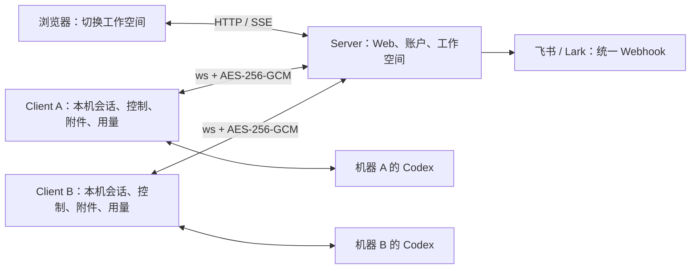

# Server / client 架构与部署

Server 提供统一 Web 界面、账户与设备授权、工作空间注册、路由和 Webhook 投递。每台运行 Codex 的机器启动一个 client，主动连接 Server 的 WebSocket。浏览器切换工作空间即可切换机器，也可以打开多个标签页同时管理。

macOS 使用普通 Node 和原生 CLI 控制会话，后台启停使用 `start.sh` / `stop.sh`，详见 [macOS client](macos-client.md)。

Windows 和 macOS 默认使用相同的 App Server 控制器，支持新会话权限选择和 Monitor 自有会话的网页审批。Windows 继续使用原后台启动器和桌面自动监测；控制、权限、CLI 发现及旧 pipe 兼容方式见 [会话控制与审批](native-control.md)。



## 启动方式

所有机器安装 Node.js 24+，运行 `npm ci`、`npm run build`。支持直接传入命令行参数，也可继续使用环境变量。Windows/macOS 后台启动器读取项目 `.env` 作为补充；直接 `npm start` / `npm run client` 不自动读取 `.env`。

| 模式 | `.env` 配置 | 行为 |
| --- | --- | --- |
| 一体启动 | `MONITOR_MODE=standalone`（默认） | 启动 Server 和本机 client，两者经过真实加密 ws 连接。沿用原 `.monitor` 的账户、回执、附件绑定、用量及通知配置。 |
| 独立 Server | `MONITOR_MODE=server` | 只启动 Web 和工作空间网关，不扫描本机 Codex，也不连接本机桌面。 |
| 独立 client | `MONITOR_MODE=client` | 只启动本机能力与到 Server 的主动 ws 连接，不开放对外 Web 端口。默认数据目录 `.monitor-client`。 |

Windows：双击 `start.cmd` 或运行 `powershell -NoProfile -ExecutionPolicy Bypass -File .\start.ps1 -Build`。停止使用 `stop.cmd`。Client 模式不会打开浏览器，进程记录与日志放在 client 数据目录（默认 `.monitor-client/server.log`、`.monitor-client/server-error.log`）；Server / 一体模式仍放在 `.monitor`。Linux/macOS 可使用相同的 npm 命令行参数，或设置环境变量后运行 `npm start`。

### Client 命令行启动

从 Server 的“管理工作空间 → 添加”取得工作空间 ID 和 AES 密钥后，在 client 机器直接执行：

```powershell
# Windows 后台启动，无需先编辑 .env
.\start.cmd -Mode client -ServerUrl "ws://192.168.1.10:9902" -WorkspaceId "注册的工作空间ID" -ClientKey "注册的AES密钥"

# 前台启动，Windows / Linux / macOS 通用，Ctrl+C 停止
npm run client -- --server-url "ws://192.168.1.10:9902" --workspace-id "注册的工作空间ID" --client-key "注册的AES密钥"

# 等价的通用入口
npm start -- --mode client --server-url "ws://192.168.1.10:9902" --workspace-id "注册的工作空间ID" --client-key "注册的AES密钥"
```

密钥保存在单独文件时，将 `-ClientKey` 换成 `-ClientKeyFile "D:\private\client.key"`；npm 使用 `--client-key-file "D:\private\client.key"`。同一次调用中只指定一种密钥来源。

| npm / Node 参数 | Windows 启动器参数 | 对应环境变量 | 用途或默认值 |
| --- | --- | --- | --- |
| `--mode` | `-Mode` | `MONITOR_MODE` | `standalone` / `server` / `client`；`npm run client` 默认 client |
| `--server-url` | `-ServerUrl` | `MONITOR_SERVER_URL` | Server 的 http(s) 或 ws(s) origin |
| `--workspace-id` | `-WorkspaceId` | `MONITOR_WORKSPACE_ID` | 注册的工作空间 ID |
| `--client-key` | `-ClientKey` | `MONITOR_CLIENT_KEY` | 43 字符 base64url AES 密钥 |
| `--client-key-file` | `-ClientKeyFile` | `MONITOR_CLIENT_KEY_FILE` | 保存密钥的私有文本文件 |
| `--codex-home` | `-CodexHome` | `CODEX_HOME` | 默认当前用户的 `.codex` |
| `--data-dir` | `-DataDir` | `MONITOR_DATA_DIR` | Client 默认 `.monitor-client` |
| `--poll-ms` | `-PollMs` | `MONITOR_POLL_MS` | 历史轮询间隔，默认 1,500 毫秒，最小 500 |
| `--pricing-file` | `-PricingFile` | `MONITOR_PRICING_FILE` | 模型价格 JSON 文件 |
| `--codex-autostart` | `-CodexAutoStart` | `MONITOR_CODEX_AUTOSTART` | `true` / `false`，Windows/macOS 默认启用桌面监测 |
| `--codex-check-ms` | `-CodexCheckMs` | `MONITOR_CODEX_CHECK_MS` | 桌面检查间隔，默认 15,000 毫秒，范围 1,000–300,000 |
| `--codex-desktop` | `-CodexDesktop` | `MONITOR_CODEX_DESKTOP` | 桌面 GUI 程序的绝对路径 |
| `--codex-cli` | `-CodexCli` | `MONITOR_CODEX_CLI` | 原生 RPC 使用的 CLI 程序 |
| `--codex-pipe` | `-CodexPipe` | `MONITOR_CODEX_PIPE` | 显式使用旧桌面 tools 通道，不提供网页审批 |
| `--host` / `--port` | `-ListenHost` / `-Port` | `HOST` / `PORT` | Server / 一体模式监听地址与端口 |

配置优先级为 **命令行参数 > 当前进程环境变量 > 项目 `.env`（Windows/macOS 后台启动器）> 默认值**。显式 `--client-key` / `-ClientKey` 会覆盖继承的密钥文件设置；显式文件参数会覆盖继承的内联密钥。仅通过环境变量配置时，仍以密钥文件为先。后台启动器的相对路径以项目目录为基准，直接 npm / Node 命令以当前工作目录为基准；带空格的路径用引号包围。

```powershell
# 自定义目录并关闭桌面自动启动
.\start.cmd -Mode client -ServerUrl "ws://192.168.1.10:9902" -WorkspaceId "注册的工作空间ID" -ClientKeyFile "D:\private\client.key" -CodexHome "D:\Codex Home" -DataDir "D:\private\monitor-client" -CodexAutoStart false

# 停止对应的后台 client；自定义过 DataDir 时须使用相同目录
.\stop.cmd -Mode client -DataDir "D:\private\monitor-client"

# 查看帮助；检查配置会验证参数及密钥文件后退出，不启动 client
.\start.cmd -Help
.\start.cmd -Mode client -ServerUrl "ws://192.168.1.10:9902" -WorkspaceId "注册的工作空间ID" -ClientKeyFile "D:\private\client.key" -CheckConfig
npm run client -- --help
```

启动器重复执行相同配置和构建会复用已运行的进程；发现后端构建已更新或显式传入 `-Build` 时，会核对进程身份并重启以加载新版本，防止新网页仍连接旧后端。配置不同会提示先停止再启动。直接运行 `npm run build` 只更新磁盘文件，随后还需运行启动器或重启由服务管理器维护的 Server / client。多个 client 可指定各自的数据目录独立启动。旧版启动器将 client 进程记录保存在 `.monitor`，升级前应先停止旧进程；若升级后仍遗留旧进程，可用 `stop.cmd -Mode standalone` 按旧记录停止。

## 添加远程 client

项目终端通过同一条加密 ws 通道转发，进程在所选 client 的会话项目目录启动，仅管理员可用，按登录设备隔离。升级时 Server 和 client 均需重新构建并重启，部署目录须保留生成的 `dist/terminal-worker.mjs` 和 `node_modules`。Windows 使用系统 PowerShell 与 ConPTY（Windows 10 1809+）；Linux/macOS 使用本机 `SHELL`，未设置时使用 `/bin/bash`。`node-pty` 含原生依赖，目标平台没有预编译包时需提供该平台的 C/C++ 编译工具链。

1. 启动 Server，通过其 Web 页面创建管理员并登录。
2. 顶栏点击“管理工作空间”，输入机器名称后“添加”。
3. 点击「复制 client 启动命令」，在 client 机器的项目目录中运行。已有远程工作空间可在对应行点击「复制连接命令」。命令包含 Server 地址、工作空间 ID 和当前 AES 密钥，请妥善保存。

如果浏览器使用 `localhost` 或 `127.0.0.1` 访问 Server，复制到其他机器时，应把命令中的 `--server-url` 改为 client 能访问的 Server 局域网 IP 或域名。

```sh
npm run client -- --server-url "ws://server-address:9902" --workspace-id "注册界面生成的工作空间ID" --client-key "注册界面生成的43字符base64url密钥"
```

如需指定此 client 运行 Codex 的用户目录，可在命令末尾追加 `--codex-home "C:\Users\your-name\.codex"`。

也可将密钥单独保存到本地私有文本文件，将命令中的 `--client-key "..."` 换成 `--client-key-file "密钥文件绝对路径"`。Windows 后台启动方式与 `.env` 配置仍可使用，见上文。

4. 启动 client 后等待连接。Windows client 默认立即及每 15 秒检查同一登录会话中的 Codex 桌面主进程，缺失时自动启动；CLI 和桌面子进程不算运行中的桌面主进程。启动或检查失败后至少等待 60 秒再尝试启动，日志写入 client 数据目录的 `server.log`，不影响 client 连接和历史读取。该用户的桌面应用启动并登录后才能发送消息及执行控制命令。
5. Server 页面显示该工作空间“在线”后，从顶栏切换即可查看和操作。

Client 地址要求为 origin，不带路径、查询和用户名密码。可使用 `ws://`；本实现的 AES 保护 WebSocket 业务负载，握手不传共享密钥。若经过反向代理，代理须支持 WebSocket Upgrade；自定义 Server 域名需加入 `MONITOR_ORIGINS`。

### 在线更新 Client

首次部署在线更新时，先手动更新并重启 Server 和 Client。之后管理员可在「管理工作空间」中点击独立 Client 名称旁的「更新」。Client 须从 Git 检出的项目目录运行生产构建，并能使用本机的 Git 上游和 npm 凭据。

客户端在启动目录执行 `git pull --ff-only` 和 `npm run build`。依赖清单有变化时会先安装依赖，切换依赖时客户端可能提前离线。构建成功后使用原启动配置重启，重新连上 Server 后页面显示更新完成。失败原因见页面状态，命令输出写入客户端日志。

### 在线更新 PM2 服务端

PM2 应用名为 `server`、工作目录为 Git 项目根目录时，管理员可以在「管理工作空间」顶部的服务端版本旁点击「更新」。首次安装此功能需在仓库中手动构建并执行 `pm2 restart server`。更新进程使用服务端现有的 PM2 用户、`PM2_HOME` 和 Git 凭据。

`git pull --ff-only` 和 `npm run build` 都在仓库根目录执行。构建输出先写到临时目录，验证后切换到仓库的 `dist`，原来的 npm 和 PM2 启动方式可以继续使用。依赖有变化时，服务会在切换依赖后离线构建，构建失败时尝试恢复上一版。更新日志为服务端数据目录下的 `server-update.log`。

### Client 连接失败

启动日志会显示 Client 协议版本。Server 和 Client 必须使用相同协议版本的构建；更新源码后执行 `npm run build` 并重启进程。`npm run client` 直接运行 `dist/server.mjs`，不会自动构建。若源码仍是旧版，须先同步完整新版源码，不能只修改协议版本常量。

`WebSocket 1006` 表示连接异常结束，需结合后面的具体原因排查：`HTTP 401` 检查工作空间 ID、AES 密钥、两端协议版本和系统时间（允许偏差 60 秒）；`HTTP 403` 检查 `MONITOR_ORIGINS` 和代理规则；`HTTP 404` 检查 Server 地址和代理路径；`HTTP 409` 表示同一工作空间已有 Client 在线；`ECONNREFUSED` 检查服务监听和端口；`Opening handshake has timed out` 检查网络、代理的 WebSocket Upgrade 和 Server 日志。底层网络错误、协议版本不一致和服务端关闭原因均写入连接日志。

桌面自动监测只在 Windows 一体模式和独立 client 中运行，与浏览器是否打开、client 是否连接 Server 无关。Client 必须由目标 Windows 用户在其交互式登录会话中运行；它不会跨用户登录或自动完成 Codex 账户登录。`.env` 可设置 `MONITOR_CODEX_AUTOSTART=false` 关闭，`MONITOR_CODEX_CHECK_MS=15000` 调整间隔（1,000–300,000 毫秒），`MONITOR_CODEX_DESKTOP=C:\path\to\app\ChatGPT.exe` 指定非标准安装的桌面 GUI 程序绝对路径。默认从 Windows Store 包及常见安装目录发现，不使用 `MONITOR_CODEX_CLI` 启动桌面。关闭 client 会取消监测，不会关闭 Codex；监测启用期间主动退出桌面后也会被重新拉起。

## 固定 AES 密钥和连接认证

- 每个工作空间生成独立 256 位随机 AES 密钥。Server 保存在私有 `monitor.sqlite` 的工作空间表，client 保存在本地配置或密钥文件。重连不派生、不轮换共享密钥。
- ws 握手使用 HMAC-SHA256 证明持有密钥，签名包含工作空间、时间戳与一次性随机数。Server 校验时间窗口和重复签名，线上不发送密钥或浏览器登录令牌。两端系统时间应保持同步，允许 60 秒偏差。
- 每条业务消息使用 AES-256-GCM、独立随机 96 位 IV 和 128 位认证标签。公开随机连接标识仅绑定认证上下文，不参与密钥派生。AAD 同时绑定协议版本、连接、本次客户端握手凭证的摘要、方向与递增序号；即使攻击者复用录制的连接标识，也无法向新连接重放旧服务端消息。
- 当前传输协议为 v3，包含通知策略、事件上报和持久化接收确认。网页完成通知通过 client 能力声明增加独立扫描边界与上报批次，需要更新 Server 和对应 client 才能使用；未声明此能力的 v3 client 保持原 Webhook 行为，固定 AES 密钥无需更换。更早协议的 client 会被拒绝接入。
- 公共连接标识、协议版本及 WebSocket 控制帧不含业务内容；请求路径、用户身份、消息、附件、响应和事件均在加密负载中。
- 管理员可以“轮换密钥”，立即断开旧连接；将新密钥更新到 client 本地并重启。旧密钥不能重新接入。同一工作空间同时只允许一个活动 client，其他连接不会挤掉现有连接。
- 默认本机工作空间的密钥由一体启动管理，保存在 `.monitor/local-client-key`，不通过 Web 页面轮换。

AES 加密范围是 Server 与 client 之间的 ws。浏览器与 Server 之间使用所访问地址的 HTTP/HTTPS；HTTP 登录仍属于该浏览器连接自身的传输范围。

## 请求与故障语义

- 工作空间受保护路由为 `/api/workspaces/:workspaceId/sessions`、`/overview`、`/control`、`/uploads`、`/usage`、`/stream`。账户、设备、工作空间管理和全局通知接口由 Server 本身处理，不经过 client 的 HTTP 转发；`/api/notifications`、`/api/notifications/test` 仅管理员可访问。所有已登录用户可通过 `GET /api/notifications/completions` 同步内存待通知列表，通过 `POST /api/notifications/completions/dismiss` 关闭其已观察到的通知；沿用 Bearer 登录校验、来源检查和 JSON 写请求保护。响应包含服务实例标识、列表版本，以及通知编号、工作空间、会话、标题和完成时间，不返回投递正文或凭据。
- 网页待通知只保存在 Server 进程内存，最多 50 条，不从浏览器存储或旧数据库事件恢复。关闭请求携带服务实例标识和明确的通知 ID 集合；“全部关闭”不会删除请求外的新通知，旧实例请求返回 409。前端以完整快照替换列表，忽略较旧版本并取消关闭前的在途读取；关闭成功后才移除或跳转，其他端下次轮询同步。数据库接收记录和 Client outbox 继续用于去重与可靠上报，重启仅清空内存待通知，重复事件不会重新入队。
- Client 只转发明确允许的本机能力路径，内部 HTTP 适配器绑定随机 loopback 端口，每个请求使用临时随机授权，不接收任意 URL、账户管理或任意文件路径。
- Client 对初始身份和实际控制提交向 Server 做反向权限复核。浏览器退出或设备撤销后进行中的 SSE 会终止，尚未实际提交的命令重新检查设备权限；已受理消息队列按当前账户管理员权限处理。
- 连接每 15 秒检测心跳，断开后按 1、2、4…30 秒退避重连。离线工作空间继续保留，页面显示离线；恢复后自动重建浏览器实时流。
- 支持资源上报的 Server 会在加密欢迎消息中声明能力。Client 连接后立即上报一次整机内存，并每 5 秒上报整机 CPU、内存；CPU 按两次系统计数器差值计算，为所有逻辑 CPU 的平均占用，首次及重新连接时需等待下一次采样。macOS 内存从物理总量中扣除 `vm_stat` 的空闲页、文件缓存页和可清除页，与活动监视器的已用内存口径对齐；按实际页大小换算，压缩内存按物理占用计入，不将全部 inactive 页当作可用内存。其他系统保留 `(总量 - 系统空闲量) / 总量` 的口径。macOS 异步采集设有超时，命令失败或计数异常时显示未知，不回退到包含缓存的高占用值，也不影响会话操作。
- 整机资源以状态标签显示在顶部工作空间选择区域和“管理工作空间”列表中；桌面端与选择器并排，窄屏分行排列。Server 仅在当前连接内存中保留最新样本，按 Server 接收时间计算数据年龄；超过 15 秒显示“数据过期”，离线后清除实时值。拥堵时跳过旧样本，不落库、不补传。新 client 连接未声明能力的旧 v3 Server 时不发送资源帧；旧 client 可继续连接新 Server，资源显示“等待上报”。此能力不改变 v3 握手及密钥。
- 传输不自动重放 HTTP 操作。发送、新建、目标、停止等继续沿用持久请求 ID。连接在提交后断开时，恢复后查询原请求回执，不能以“连接断开”认定操作未执行。
- 通知事件使用独立的持久化上报日志：Client 按批上报，Server 提交 SQLite 队列后确认。确认丢失时可安全重传，Server 按已认证的工作空间、会话及轮次／问题 ID 去重；Client 无法指定其他工作空间或接收地址。每批最多 4 条并限制 UTF-8 大小，问题解决事件优先上报，Server 也优先投递问题提醒。
- 每个 client 最多承接 64 个在途请求。上传和响应均按 48 KiB 分片，分别等待 client 接收和浏览器消费确认后继续传输；单帧最多约 136 KiB，避免整份附件的加密与解析阻塞其他会话。120 秒无进展会取消，并关闭本地请求流。附件最多 20 MiB，每个 Server 最多同时处理 4 个、单账户 2 个，配额持续占用到 client 响应结束或浏览器取消；其他路由拒绝二进制请求体。client 继续执行本地限流和归属验证。
- 图片 GET 接口可携带 `variant=thumbnail|preview|original` 和 `format=avif|webp|original`；未指定时保留原文件响应。浏览器通过本地解码探测选择格式，client 在传输前生成最多 720 × 480／2560 × 2560 的预览，最多同时编码 2 张、在途 24 份、排队源缓冲 64 MiB，单张最多 3200 万像素、编码限时 5 秒；超限或无收益时返回原图。每个 client 使用独立的 32 MiB／128 项、5 分钟内存缓存，文件大小／修改及元数据变更时间／文件标识或图片内容哈希参与版本校验；每次请求仍先验证会话引用或附件归属，缓存不绕过认证，HTTP 响应保持 `no-store`。原文件读取和附件发送不做有损改写。
- 网页地址携带工作空间 ID。切换时导航到该工作空间，终止旧页面请求；草稿、附件及待确认回执按工作空间和用户隔离。登录与主题共享，草稿仍只保存在当前标签页。

## 数据归属

Server 保存账户、设备授权、工作空间注册，以及所有工作空间共用的 Webhook 配置、签名密钥、投递队列和历史。Server 负责消息格式、签名、限时调用和退避重试；消息包含工作空间名称，链接包含工作空间 ID。没有在线 Client 时仍可管理配置和发送测试通知，已经受理的通知继续投递。

远程 client 的操作队列、回执、附件、用量缓存，以及通知扫描断点、待上报事件和待回答问题状态保存在该 client 的本机数据目录。Client 只接收通知开关、扫描边界和配置版本，不接收 Webhook 或签名密钥。Server 停机或连接中断期间继续保留事件；Server 持久化确认前不清除上报正文。问题解决后向 Server 上报取消事件，未回答的问题不会因为五分钟回扫窗口而取消。

独立 client 升级时自动停用原本机发送器，清除旧 Webhook 和签名密钥，取消旧本机待投递记录。原远程 client 的接收配置不自动覆盖 Server 全局配置；请在 Server 的设置中填写统一接收地址。一体模式的原通知配置和待投递队列继续保留在 Server 私有数据库中。

一体模式本机 client 沿用原私有数据库，历史配置无需迁移。切换为纯 Server 模式时，本机运行器停止，原本机数据仍保留；要继续查看本机 Codex，应恢复一体模式或单独注册本机 client。
